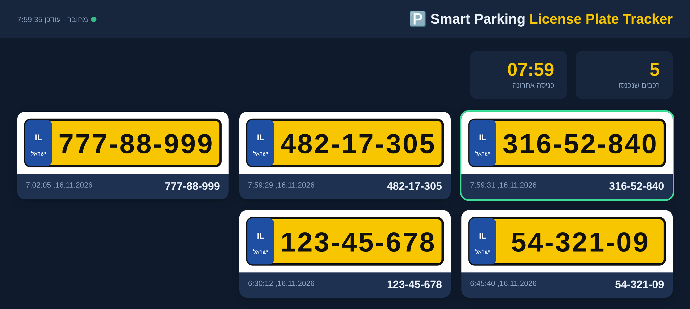

# 🅿️ Smart Parking License Plate Tracker

מערכת לניהול כניסת רכבים לחניון חכם – **Track 1 (Lite): Nginx + Apache + Docker Compose**.

מצלמת IoT מצלמת את לוחית הרישוי של כל רכב שנכנס ושומרת את התמונה בשרת אחסון ייעודי.
השומר פותח לוח בקרה בדפדפן ורואה את כל הרכבים שנכנסו – הרשימה מתעדכנת אוטומטית כל 5 שניות.




## ארכיטקטורה

```
                 ┌──────────────── parking-net (bridge) ────────────────┐
 Guard browser   │  ┌──────────────┐  /storage/*   ┌──────────────────┐ │
 :8080  ───────────▶│ web (Nginx)  │ ─────────────▶│ storage (Apache) │ │
                 │  │ index.html   │  proxy_pass   │ /htdocs/images   │ │
                 │  └──────────────┘               └────────▲─────────┘ │
                 └──────────────────────────────────────────│───────────┘
                                          volume (bind mount)│
 IoT camera ── saves photo.png ──▶  ./storage/images  ───────┘
```

| שירות | Image | פורט | תפקיד |
|---|---|---|---|
| `web` | `nginx:1.27-alpine` | 8080 | מגיש את לוח הבקרה (HTML/JS) ומשמש Reverse Proxy ל-storage |
| `storage` | `httpd:2.4-alpine` | 8081 | שרת אחסון בלבד – מגיש את תמונות הלוחיות |

## מבנה הפרויקט

```
smart-parking-tracker/
├── docker-compose.yml          # אורקסטרציה: 2 שירותים, רשת, volume (bind mount)
├── web/
│   ├── Dockerfile              # nginx + הקונפיג + הדשבורד
│   ├── nginx.conf              # הגשת HTML + proxy ל-/storage/
│   └── index.html              # לוח הבקרה לשומר
├── storage/
│   ├── Dockerfile              # httpd – שרת אחסון בלבד
│   └── images/                 # 📸 תיקיית המצלמה – כל תמונה כאן מופיעה בדשבורד
├── camera/samples/             # תמונות לוחיות לדוגמה (PNG) לסימולציית המצלמה
├── scripts/
│   ├── simulate-camera.sh      # סימולציית מצלמה (Linux/Mac/Git Bash)
│   └── simulate-camera.ps1     # סימולציית מצלמה (Windows PowerShell)
└── .github/workflows/
    └── docker-ci.yml           # CI/CD: build + בדיקות + push ל-GHCR
```

## הרצה

```bash
docker compose up -d --build
```

- לוח הבקרה: http://localhost:8080
- שרת האחסון ישירות: http://localhost:8081/images/

### רכב חדש נכנס – הוספת תמונה

התיקייה `storage/images` במחשב **מחוברת ישירות** לתיקיית התמונות של Apache (bind mount).
המצלמה שומרת בה את תמונת הלוחית – וכל תמונה (`.png` / `.jpg` / `.jpeg` / `.webp`) שנכנסת לתיקייה מופיעה בדשבורד תוך 5 שניות, עם מסגרת ירוקה.

**דרך 1 – ידנית:** להעתיק / לגרור תמונת לוחית לתיקייה `storage/images`.
- שם הקובץ = מספר הלוחית, למשל `905-31-462.png`. השעה נלקחת מזמן שמירת הקובץ.
- או בפורמט המצלמה `<לוחית>_<YYYYMMDD-HHMMSS>.png`, למשל `905-31-462_20261117-081500.png`.

**דרך 2 – סימולציית מצלמה:** הסקריפט מעתיק תמונה מ-`camera/samples` עם חותמת זמן:

```bash
./scripts/simulate-camera.sh              # לוחית אקראית
./scripts/simulate-camera.sh 482-17-305   # לוחית מסוימת (מתוך camera/samples)
```

ב-Windows:

```powershell
powershell -ExecutionPolicy Bypass -File .\scripts\simulate-camera.ps1 -Plate 482-17-305
```

## Data Persistence – הדגמה

```bash
./scripts/simulate-camera.sh 482-17-305
docker compose down          # הקונטיינרים נמחקים
docker compose up -d         # עולים מחדש
# הרכב 482-17-305 עדיין מופיע!
# התמונות שמורות במחשב (storage/images) ולא בתוך הקונטיינר –
# ה-volume מחבר את התיקייה לקונטיינר, ולכן היא שורדת גם down -v
```

## CI/CD

ה-Workflow ‏`.github/workflows/docker-ci.yml` רץ בכל `push` ו-Pull Request:

1. בודק שה-`docker-compose.yml` תקין
2. בונה את שני ה-Images
3. מרים את המערכת ומריץ Smoke tests עם `curl` (דשבורד, proxy, סימולציית מצלמה, תמונה שהועתקה ידנית לתיקייה)
4. **בונוס:** בכל push ל-`main` – מעלה את ה-Images ל-GitHub Container Registry:
   - `ghcr.io/<owner>/parking-web`
   - `ghcr.io/<owner>/parking-storage`

## עבודת צוות

- כל חבר צוות עובד ב-branch משלו (`feature/...`) ופותח Pull Request ל-`main`
- ה-CI חייב לעבור לפני Merge
- לפחות commit אחד מכל חבר צוות

| חבר צוות | אחריות |
|---|---|
| איתי טריגלו | שירות web: Nginx + לוח הבקרה · CI/CD + העלאה ל-GHCR |
| אור חיים עזרייה | שירות storage: Apache + Volume · סימולציית מצלמה · README |

## פתרון בעיות ב-Windows

| הודעת שגיאה | פתרון |
|---|---|
| `'docker' is not recognized` | להתקין Docker Desktop: https://www.docker.com/products/docker-desktop |
| `failed to connect to the docker API` | לפתוח את Docker Desktop ולחכות ל-"Engine running" |
| הסקריפט `simulate-camera.ps1` נחסם | להריץ עם `powershell -ExecutionPolicy Bypass -File .\scripts\simulate-camera.ps1` |
| תמונה לא מופיעה בדשבורד | לוודא שהקובץ בתיקייה `storage\images` ושהסיומת היא png / jpg / webp |
